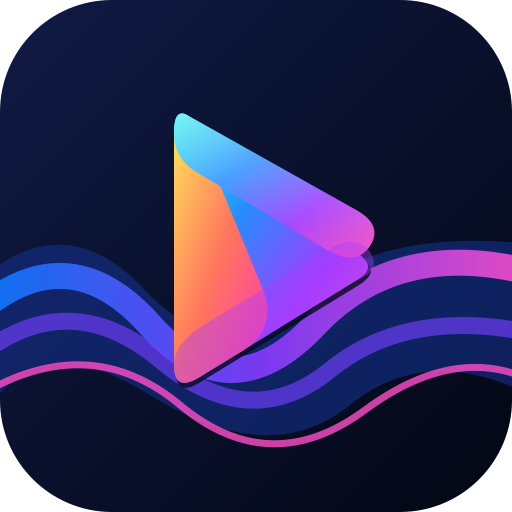
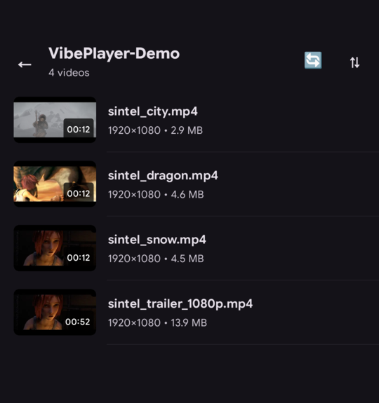
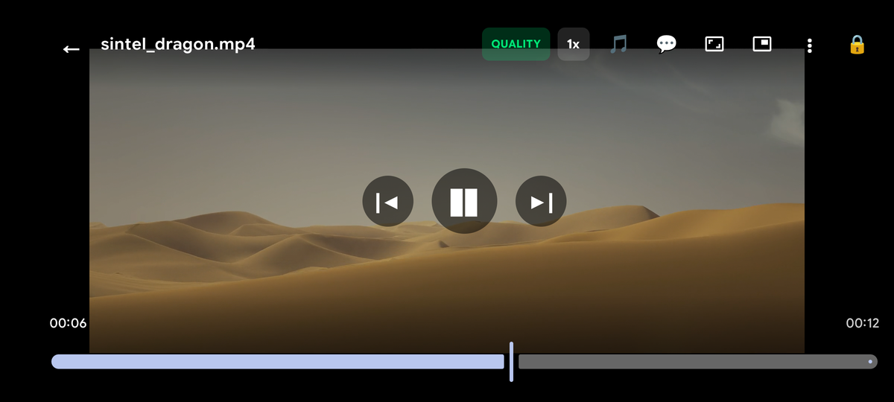
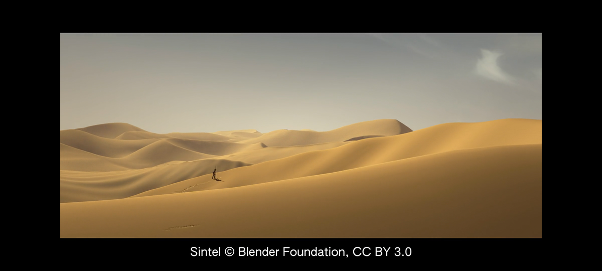
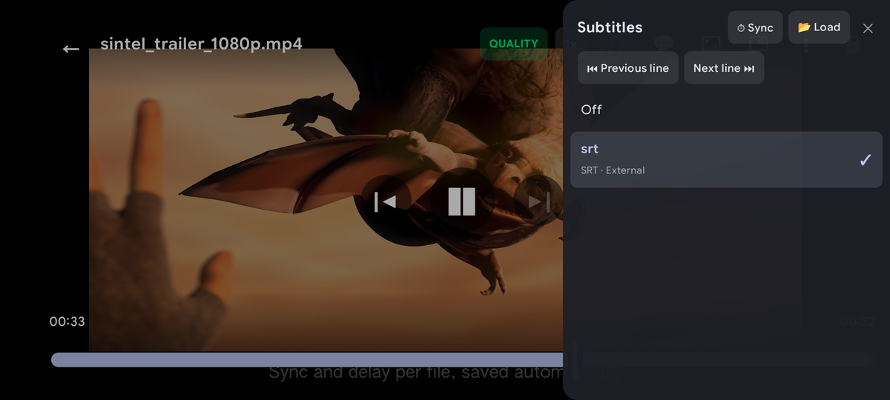
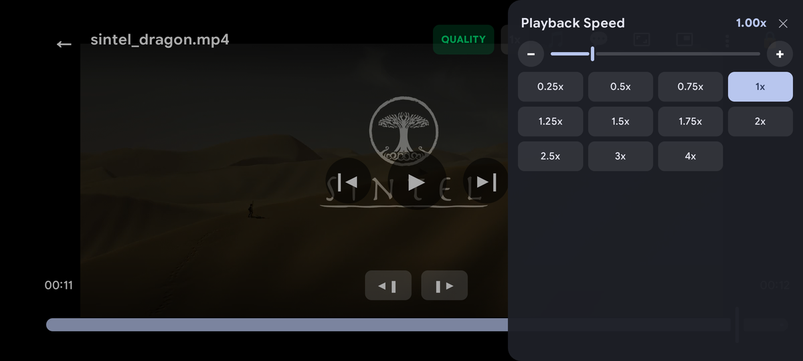
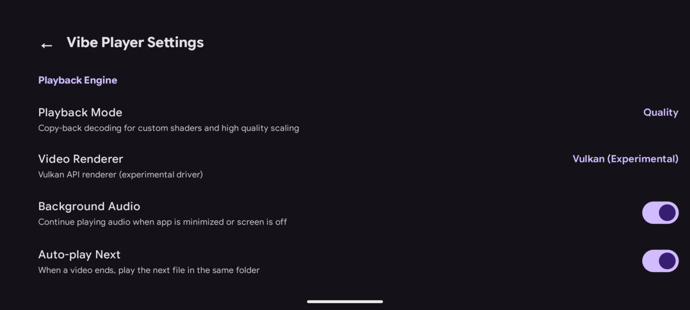

<p align="center"></p>

<h1 align="center">Vibe Player</h1>

<p align="center">
  
  
  
</p>

Vibe Player is a personal Android video player built on libmpv, with MX Player-style touch gestures,
styled ASS subtitles, hardware decoding where the phone supports it and software AV1 where it does not.
It is developed for one phone (POCO X5 Pro 5G) and published as is.

## Screenshots

<table>
  <tr>
    <td align="center" rowspan="2"><br>Folder view</td>
    <td align="center"><br>Player</td>
    <td align="center"><br>Subtitles</td>
  </tr>
  <tr>
    <td align="center"><br>Subtitle sheet</td>
    <td align="center"><br>Playback speed</td>
  </tr>
  <tr>
    <td></td>
    <td align="center" colspan="2"><br>Settings</td>
  </tr>
</table>

Screenshots show [Sintel](https://durian.blender.org/) (© Blender Foundation, CC BY 3.0).

## Features

Features marked **beta** are merged but their device check is not finished (see [PROGRESS.md](PROGRESS.md)).

- Gestures: brightness (left vertical swipe), volume (right vertical swipe), horizontal swipe seek with position preview, double-tap skip, pinch zoom and pan, lock, haptics; hold for fast playback (**beta**)
- Hardware decoding of H.264, HEVC and VP9 through MediaCodec; AV1 with dav1d on all cores
- Styled ASS subtitles with embedded fonts (libass); audio and subtitle track pickers
- External subtitle loading via Storage Access Framework (SAF) document picker with persistent track memory and automatic re-attachment on reopen
- Subtitle and audio delay in 50 ms steps, saved per file
- Subtitle size, position and ASS style override settings
- Speed 0.25x to 4x with pitch correction; aspect modes (fit, crop, stretch, 16:9, 4:3)
- Per-file memory of position, tracks, speed and aspect; per-folder track memory and default languages
- Auto-play of the next file in the folder; previous / next
- Picture-in-picture mini player with aspect-ratio clamping, auto-enter on home, and auto-advance inside the mini player
- Background playback in a foreground service with a media notification (**beta**)
- Folder browser with thumbnails (software thumbnails for AV1 and 10-bit video with dark-frame detection) and a Continue Watching row with progress bars
- Best configuration per format chosen before opening (Auto renderer, the default), from a table measured on the reference phone and keyed by the Vulkan driver build, with a Vulkan -> OpenGL ES -> software fallback chain
- Renderer setting: Auto, OpenGL ES, or Vulkan (experimental: needs the owner's driver port)
- Quality mode (`gpu-next`, MediaCodec copy-back) next to the Efficient mode (**beta**)
- Anime4K (A, B, C) and Snapdragon GSR shader presets in Quality mode (**beta**)
- Platform integration (Android 17):
  - Display refresh rate adaptation via `Surface.setFrameRate` matching video container framerate
  - Thermal throttling adaptation (`PowerManager` monitoring with automatic quality step-down) (**beta**)
  - Edge-to-edge layout with display cutout support (`LAYOUT_IN_DISPLAY_CUTOUT_MODE_ALWAYS`)
  - Predictive back navigation (`enableOnBackInvokedCallback="true"`) (**beta**)
  - Historical process exit diagnostics (`ActivityManager.getHistoricalProcessExitReasons`, logged as `VibeExit` and displayed in Settings)
- Performance:
  - Tuned native libraries compiled with `-O2 -mcpu=cortex-a78 -flto=thin` optimized for Snapdragon 778G Cortex-A78 cores
  - Starts playing in about 0.9 s (median 882 ms for 1080p H.264, 798 ms for `ichiban.mp4`)
  - About 216 MB of memory while playing 1080p H.264, about 110 MB for browser after closing the player (release build)
  - 0 to 0.5% janky frames on fast folder scrolls (release build)

### Format and renderer table

What Auto picks on the reference phone (`player/src/main/assets/format_table.json`, Vulkan driver
`c0b92d25178c8b21`; the same rows apply for an unknown driver). Numbers are from 60 s runs on battery
([docs/BENCHMARK.md](docs/BENCHMARK.md), "Power comparison").

| Format | Renderer | `vo` | Decoder | Without Vulkan | Why |
|---|---|---|---|---|---|
| H.264 8-bit | Vulkan | `gpu-next` | MediaCodec copy-back | OpenGL ES `gpu`, copy-back | 0 drops, 549 mA (lowest); zero-copy excluded for start stalls (B-08) |
| HEVC (8/10-bit) | OpenGL ES | `gpu` | MediaCodec zero-copy | (same) | 604 mA vs 1254 mA on Vulkan, drops equal within 5% |
| VP9 | OpenGL ES | `gpu` | MediaCodec zero-copy | (same) | 0 drops, 339 mA vs 794-1026 mA |
| AV1 | Vulkan | `gpu` | Software (dav1d) | OpenGL ES `gpu`, software | 362 drops vs 385 (`gpu-next`) and 918 (OpenGL ES) on 4K |
| H.264 10-bit (Hi10P) | Vulkan | `gpu` | Software | OpenGL ES `gpu`, software | no hardware decoder on the 778G |
| Other | OpenGL ES | `gpu` | Software | (same) | safe default |

**Fallback chain**: if Vulkan fails to start or fails at runtime, playback continues on OpenGL ES; if the
hardware decoder fails on OpenGL ES, it continues with software decoding. The position is kept and a short
notice is shown.

## Requirements and compatibility

Android 17 (minSdk 37) on an arm64-v8a device; OpenGL ES 3.x. The Vulkan renderer needs Vulkan 1.2 or newer
(libplacebo); otherwise the app uses OpenGL ES. Tested on one phone only (POCO X5 Pro 5G, Snapdragon 778G). See
[docs/HARDWARE.md](docs/HARDWARE.md) for the reference device, measured numbers, what might work elsewhere and
what will not.

## Known issues

- **Start stall (B-08)**: MediaCodec sometimes never delivers the first frame of an H.264 file (1 in 10 to 1 in
  20 cold opens on the default row). A watchdog recovers it within 6 to 10 seconds; it never stays black.
- **Anime4K on OpenGL ES**: the phone's Adreno GLES compiler rejects some Anime4K passes (libplacebo's
  texture-offset macro through its alias); the failing stages are skipped and the rest run. Anime4K works fully on
  Vulkan; Snapdragon GSR works on both.
- **External subtitles**: `.srt` / `.ass` files next to a video in shared storage are not auto-loaded on
  Android 13 and later, because the app only asks for access to videos; users can load them via the "Load subtitle file…" SAF picker.
- **Vulkan is experimental**: it depends on the owner's unfinished Vulkan 1.3 driver port.

## Download

Releases and pre-built APKs are available on the [GitHub Releases](https://github.com/ravarage/vibeplayer/releases) page.

## Install

1. Download `VibePlayer-0.6.0-arm64.apk` (the latest release) and `SHA256SUMS` from the [GitHub Releases](https://github.com/ravarage/vibeplayer/releases/tag/v0.6.0) page.
2. Verify the SHA-256 checksum:
   ```sh
   sha256sum -c SHA256SUMS
   ```
3. Install the APK via adb:
   ```sh
   adb install -r VibePlayer-0.6.0-arm64.apk
   ```

Requirements: Android 17 (arm64-v8a) on the reference device (POCO X5 Pro 5G). The APK is signed with the developer's debug key, so it updates in place only over builds signed with the same key; builds from source signed with your own key must be uninstalled first (this deletes app data).

## Building from source

See [docs/BUILDING.md](docs/BUILDING.md): the native libraries are built from pinned sources with
`native/fetch.sh` and `native/build.sh`, the app with `./gradlew :app:assembleRelease`.

## How it was developed

A human owner directed AI coding agents. Claude acted as architect and reviewer (plus helper agents); Google
Antigravity CLI (agy, Gemini) and OpenAI Codex were the implementing agents. They worked from
[SPEC.md](SPEC.md), [ARCHITECTURE.md](ARCHITECTURE.md) and [TASKS.md](TASKS.md) with one commit per task, rules in
[AGENT_RULES.md](AGENT_RULES.md), and a progress log in [PROGRESS.md](PROGRESS.md) and
[BLOCKERS.md](BLOCKERS.md). Changes were verified on the phone with screenshot-based checks
(`tools/check_video.py`) and a regression suite (`tools/devcheck`). The planning files are part of the repository.

## Roadmap

See [docs/ROADMAP.md](docs/ROADMAP.md): the remaining device checks, longer renderer benchmarks, the rest of
the performance work, the shader benchmark and the tuned native build.

## License

Copyright (C) 2026 Ravyar Tahir ([ravarage](https://ravarage.xyz/)).

GPL-3.0-or-later; see [LICENSE](LICENSE). The app is GPL because FFmpeg is built with GPL options
(`--enable-gpl --enable-version3`), which makes the bundled libmpv binaries GPL. Third-party components and
how to get the corresponding source are in [THIRD_PARTY_NOTICES.md](THIRD_PARTY_NOTICES.md).

## Contact

Ravyar Tahir ([ravarage on GitHub](https://github.com/ravarage), [ravarage.xyz](https://ravarage.xyz/)): ravyar.tahir@ravarage.xyz

## Acknowledgements

[mpv](https://mpv.io), [mpv-android](https://github.com/mpv-android/mpv-android), [FFmpeg](https://ffmpeg.org),
[dav1d](https://code.videolan.org/videolan/dav1d), [libass](https://github.com/libass/libass),
[libplacebo](https://code.videolan.org/videolan/libplacebo), [Anime4K](https://github.com/bloc97/Anime4K),
Qualcomm Snapdragon Game Super Resolution (mpv port by agyild). MX Player was the inspiration for the touch
interface; Vibe Player is not affiliated with or endorsed by MX Player or any other project named here.
